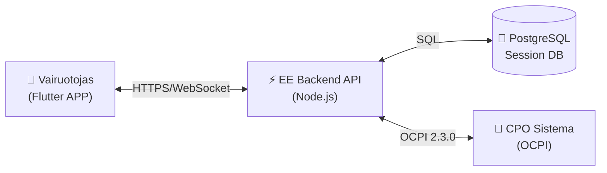
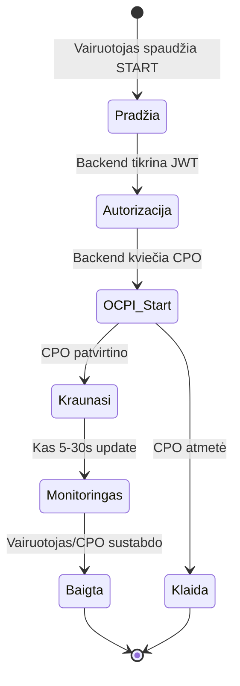
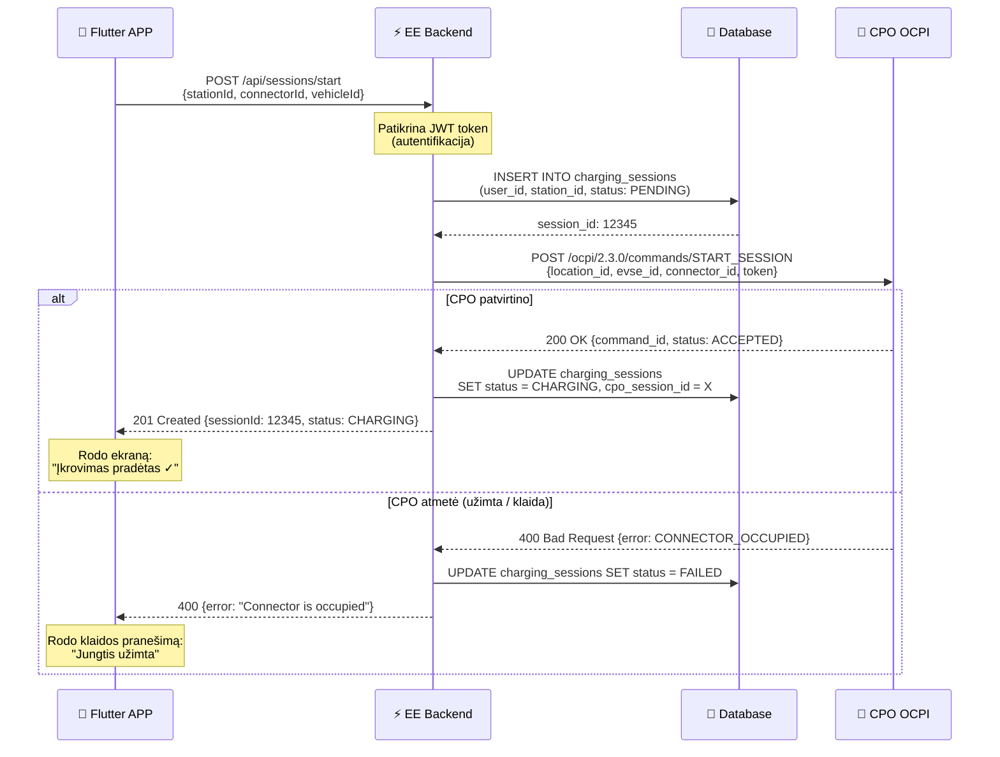
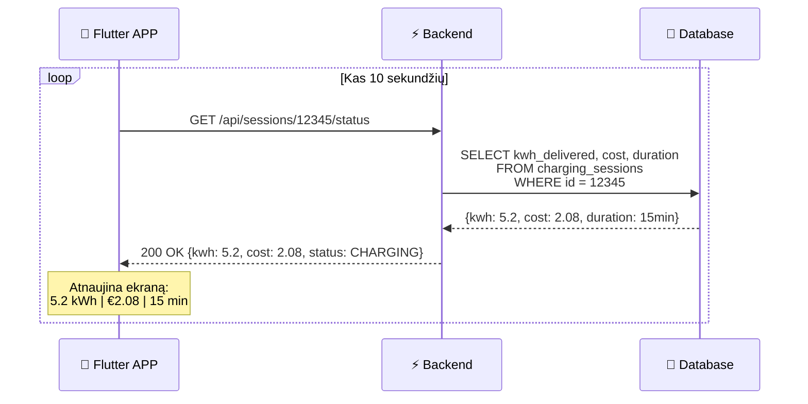
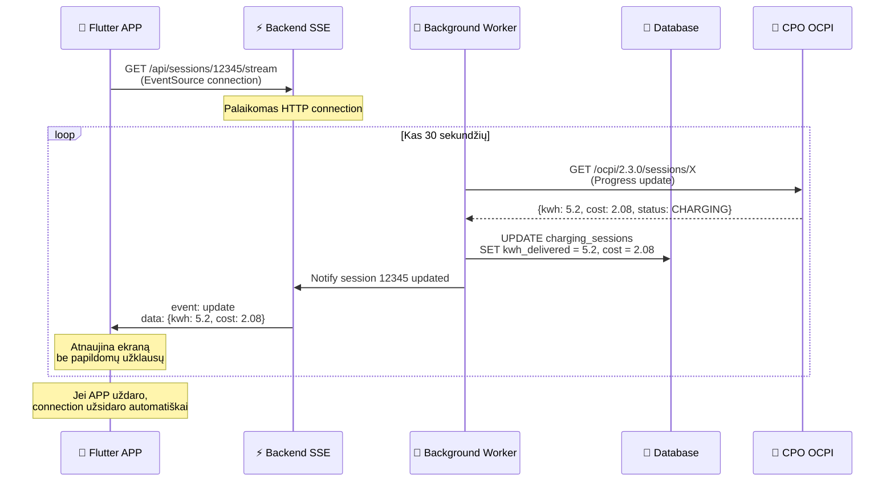
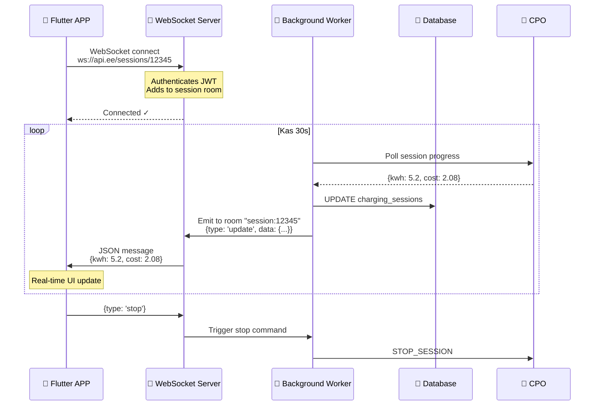
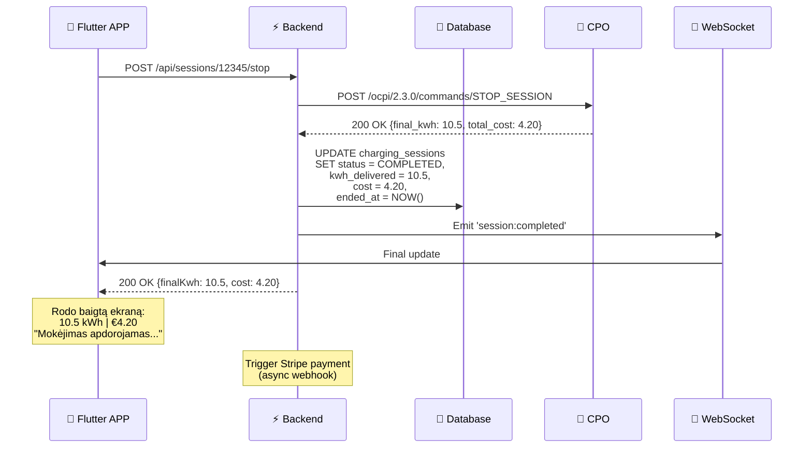

# Real-Time Įkrovimo Sesijų Atvaizdavimas

**Tikslas**: Paaiškinti kaip veikia informacijos atvaizdavimas apie automobilio įkrovimą kai yra daug vartotojų vienu metu.

**Paskutinis atnaujinimas**: 2026-09-30

---

## 1. Sistemos Dalyviai



**Pagrindiniai dalyviai:**
- **Flutter APP** — vairuotojo mobilė aplikacija
- **EE Backend API** — mūsų serveris (Node.js + Express)
- **PostgreSQL** — sesijų duomenų bazė
- **CPO Sistema** — įkrovimo stotelės operatoriaus sistema (pvz., Ignitis ON, Via Lietuva)

---

## 2. Įkrovimo Sesijos Gyvavimo Ciklas

### Fazės:



---

## 3. PRADĖTI Įkrovimą (START)

### 3.1 Kas Vyksta Kai Vairuotojas Spaudžia "START"



### 3.2 Backend Kodas (Supaprastintas)

```typescript
// POST /api/sessions/start
async function startChargingSession(req, res) {
  const { stationId, connectorId } = req.body;
  const userId = req.user.id; // iš JWT token
  
  // 1. Sukurti sesijos įrašą DB
  const session = await db.chargingSessions.create({
    userId,
    stationId,
    connectorId,
    status: 'PENDING',
    startedAt: new Date()
  });
  
  try {
    // 2. Siųsti komandą į CPO per OCPI
    const ocpiResponse = await ocpiClient.startSession({
      locationId: station.externalId,
      evseId: connector.externalEvseId,
      connectorId: connector.externalConnectorId,
      authToken: user.rfidToken
    });
    
    if (ocpiResponse.status === 'ACCEPTED') {
      // 3. Atnaujinti sesijos statusą
      await db.chargingSessions.update({
        where: { id: session.id },
        data: {
          status: 'CHARGING',
          cpoSessionId: ocpiResponse.sessionId
        }
      });
      
      // 4. Pradėti monitoringą (background job)
      await startSessionMonitoring(session.id);
      
      return res.status(201).json({
        sessionId: session.id,
        status: 'CHARGING',
        message: 'Charging started successfully'
      });
    }
  } catch (error) {
    // Klaida - atnaujinti DB ir grąžinti 400
    await db.chargingSessions.update({
      where: { id: session.id },
      data: { status: 'FAILED', error: error.message }
    });
    
    return res.status(400).json({ error: error.message });
  }
}
```

---

## 4. REAL-TIME Monitoringas (KAI KRAUNA)

### 4.1 Trijų Būdų Palyginimas

| Metodas | Kaip Veikia | Pranašumai | Trūkumai | Scalability |
|---------|-------------|------------|----------|-------------|
| **1. Polling** | APP kas 5-30s klausia API | Paprastas | Daug bereikalingų užklausų | ⭐⭐ Silpnas |
| **2. Server-Sent Events (SSE)** | Serveris siunčia events į APP | Vienpusis, HTTP | Viena kryptis | ⭐⭐⭐ Vidutinis |
| **3. WebSocket** | Abipusis realtime kanalas | Tikras real-time | Sudėtingesnis setup | ⭐⭐⭐⭐ Geras |

**Rekomenduojama**: **SSE** MVP fazei, **WebSocket** produkcijai su >1000 vartotojų.

---

### 4.2 Variantas A: POLLING (Paprastas, bet ne optimalus)



#### Problema su Daug Vartotojų:

```
1000 vartotojų × 6 užklausų/min = 6,000 užklausų/min = 100 RPS
```

**Sprendimas**: Rate limiting + caching (Redis).

---

### 4.3 Variantas B: SERVER-SENT EVENTS (Rekomenduojama MVP)



#### Backend Kodas (SSE):

```typescript
// GET /api/sessions/:id/stream
app.get('/api/sessions/:id/stream', async (req, res) => {
  const sessionId = req.params.id;
  
  // SSE headers
  res.setHeader('Content-Type', 'text/event-stream');
  res.setHeader('Cache-Control', 'no-cache');
  res.setHeader('Connection', 'keep-alive');
  
  // Siųsti pradinį įvykį
  const session = await getSession(sessionId);
  res.write(`data: ${JSON.stringify(session)}\n\n`);
  
  // Subscribe į session updates
  const listener = (update) => {
    if (update.sessionId === sessionId) {
      res.write(`data: ${JSON.stringify(update)}\n\n`);
    }
  };
  
  sessionEmitter.on('session:update', listener);
  
  // Cleanup kai connection užsidaro
  req.on('close', () => {
    sessionEmitter.off('session:update', listener);
    res.end();
  });
});
```

#### Flutter Kodas (SSE Client):

```dart
import 'package:eventsource/eventsource.dart';

class ChargingSessionService {
  EventSource? _eventSource;
  
  Stream<ChargingUpdate> watchSession(String sessionId) async* {
    final url = '$apiUrl/sessions/$sessionId/stream';
    
    _eventSource = await EventSource.connect(
      url,
      headers: {'Authorization': 'Bearer $token'},
    );
    
    await for (final event in _eventSource!.events) {
      if (event.event == 'update') {
        final data = jsonDecode(event.data!);
        yield ChargingUpdate.fromJson(data);
      }
    }
  }
  
  void disconnect() {
    _eventSource?.close();
  }
}

// UI Widget
class LiveChargingScreen extends ConsumerWidget {
  @override
  Widget build(BuildContext context, WidgetRef ref) {
    final sessionId = ref.watch(currentSessionIdProvider);
    
    return StreamBuilder<ChargingUpdate>(
      stream: ref.read(chargingServiceProvider).watchSession(sessionId),
      builder: (context, snapshot) {
        if (!snapshot.hasData) return CircularProgressIndicator();
        
        final update = snapshot.data!;
        return Column(
          children: [
            Text('${update.kwhDelivered} kWh'),
            Text('€${update.cost.toStringAsFixed(2)}'),
            Text('${update.duration} minutes'),
          ],
        );
      },
    );
  }
}
```

---

### 4.4 Variantas C: WEBSOCKET (Geriausias scalability)



#### Backend (WebSocket Server):

```typescript
import { Server as SocketIOServer } from 'socket.io';

const io = new SocketIOServer(server, {
  cors: { origin: '*' }
});

// Middleware: JWT authentication
io.use((socket, next) => {
  const token = socket.handshake.auth.token;
  const user = verifyJWT(token);
  if (user) {
    socket.userId = user.id;
    next();
  } else {
    next(new Error('Authentication failed'));
  }
});

io.on('connection', (socket) => {
  console.log(`User ${socket.userId} connected`);
  
  // Join session room
  socket.on('join_session', (sessionId) => {
    socket.join(`session:${sessionId}`);
    console.log(`User joined session ${sessionId}`);
  });
  
  // Leave session
  socket.on('leave_session', (sessionId) => {
    socket.leave(`session:${sessionId}`);
  });
  
  socket.on('disconnect', () => {
    console.log(`User ${socket.userId} disconnected`);
  });
});

// Background worker emits updates
export function emitSessionUpdate(sessionId: string, data: any) {
  io.to(`session:${sessionId}`).emit('session:update', data);
}
```

#### Flutter (WebSocket Client):

```dart
import 'package:socket_io_client/socket_io_client.dart' as IO;

class WebSocketService {
  IO.Socket? socket;
  
  void connect(String sessionId) {
    socket = IO.io('https://api.eniwhere.com', <String, dynamic>{
      'transports': ['websocket'],
      'auth': {'token': 'Bearer $token'}
    });
    
    socket!.on('connect', (_) {
      print('Connected to WebSocket');
      socket!.emit('join_session', sessionId);
    });
    
    socket!.on('session:update', (data) {
      // Atnaujinti Riverpod state
      ref.read(chargingSessionProvider.notifier).update(data);
    });
    
    socket!.on('disconnect', (_) => print('Disconnected'));
    
    socket!.connect();
  }
  
  void disconnect() {
    socket?.disconnect();
  }
}
```

---

## 5. Background Worker (Progress Monitoring)

### 5.1 Kaip Backend Gauna Progress iš CPO

```typescript
// Background job (runs every 30s for active sessions)
import cron from 'node-cron';

// Kas 30 sekundžių
cron.schedule('*/30 * * * * *', async () => {
  const activeSessions = await db.chargingSessions.findMany({
    where: { status: 'CHARGING' }
  });
  
  for (const session of activeSessions) {
    try {
      // 1. Klausia CPO apie progresą
      const progress = await ocpiClient.getSessionProgress(session.cpoSessionId);
      
      // 2. Atnaujina DB
      await db.chargingSessions.update({
        where: { id: session.id },
        data: {
          kwhDelivered: progress.kwh,
          cost: progress.totalCost,
          duration: calculateDuration(session.startedAt),
          lastUpdated: new Date()
        }
      });
      
      // 3. Emit update (SSE arba WebSocket)
      emitSessionUpdate(session.id, {
        kwh: progress.kwh,
        cost: progress.totalCost,
        duration: calculateDuration(session.startedAt),
        status: progress.status
      });
      
    } catch (error) {
      console.error(`Failed to update session ${session.id}:`, error);
      // Nesustabdyti kitų sesijų monitoringo
    }
  }
});
```

---

## 6. BAIGTI Įkrovimą (STOP)



---

## 7. SCALABILITY: Daug Vartotojų Vienu Metu

### 7.1 Problema

```
Scenario: 1000 vartotojų krauna vienu metu
- Polling: 1000 × 6 req/min = 6000 req/min = 100 RPS
- SSE: 1000 open connections (manageable)
- WebSocket: 1000 open connections (+ bidirectional)
```

### 7.2 Sprendimai

#### A. Redis Caching (Visi metodai)

```typescript
import Redis from 'ioredis';
const redis = new Redis();

async function getSessionStatus(sessionId: string) {
  // 1. Tikrinti cache
  const cached = await redis.get(`session:${sessionId}`);
  if (cached) {
    return JSON.parse(cached);
  }
  
  // 2. Jei nėra cache, klausia DB
  const session = await db.chargingSessions.findUnique({
    where: { id: sessionId }
  });
  
  // 3. Cache 10 sekundžių
  await redis.setex(`session:${sessionId}`, 10, JSON.stringify(session));
  
  return session;
}

// Background worker atnaujina cache
function updateSessionCache(sessionId: string, data: any) {
  redis.setex(`session:${sessionId}`, 10, JSON.stringify(data));
}
```

#### B. Rate Limiting (Polling)

```typescript
import rateLimit from 'express-rate-limit';

const sessionStatusLimiter = rateLimit({
  windowMs: 60 * 1000, // 1 minutė
  max: 10, // Max 10 užklausų per minutę
  message: 'Too many requests, please slow down'
});

app.get('/api/sessions/:id/status', sessionStatusLimiter, getSessionStatus);
```

#### C. Connection Pooling (WebSocket)

```typescript
// Cluster mode (multiple processes)
import cluster from 'cluster';
import { setupMaster } from '@socket.io/sticky';
import { createAdapter } from '@socket.io/redis-adapter';

if (cluster.isMaster) {
  // Master process
  const httpServer = createServer();
  setupMaster(httpServer, {
    loadBalancingMethod: 'least-connection'
  });
  
  // Fork workers (one per CPU core)
  const numWorkers = os.cpus().length;
  for (let i = 0; i < numWorkers; i++) {
    cluster.fork();
  }
  
} else {
  // Worker process
  const io = new Server(httpServer);
  
  // Redis adapter for multi-process communication
  const pubClient = new Redis();
  const subClient = pubClient.duplicate();
  io.adapter(createAdapter(pubClient, subClient));
  
  // Handle connections...
}
```

**Rezultatas**: Sistema gali handle 10,000+ concurrent connections.

---

## 8. Database Schema

```sql
CREATE TABLE charging_sessions (
  id UUID PRIMARY KEY DEFAULT gen_random_uuid(),
  user_id UUID NOT NULL REFERENCES users(id),
  station_id UUID NOT NULL REFERENCES stations(id),
  connector_id UUID NOT NULL REFERENCES connectors(id),
  
  -- OCPI
  cpo_session_id VARCHAR(255), -- CPO pusėje session ID
  
  -- Status
  status VARCHAR(50) NOT NULL, -- PENDING, CHARGING, COMPLETED, FAILED
  error TEXT,
  
  -- Progress
  kwh_delivered DECIMAL(10,2) DEFAULT 0,
  cost DECIMAL(10,2) DEFAULT 0,
  
  -- Timestamps
  started_at TIMESTAMP NOT NULL DEFAULT NOW(),
  ended_at TIMESTAMP,
  last_updated TIMESTAMP DEFAULT NOW(),
  
  -- Payment
  payment_intent_id VARCHAR(255), -- Stripe
  payment_status VARCHAR(50) DEFAULT 'PENDING'
);

-- Index for active sessions monitoring
CREATE INDEX idx_active_sessions ON charging_sessions(status, last_updated)
WHERE status = 'CHARGING';

-- Index for user history
CREATE INDEX idx_user_sessions ON charging_sessions(user_id, started_at DESC);
```

---

## 9. Monitoring & Alerts

### 9.1 Metrics to Track

```typescript
import prometheus from 'prom-client';

// Counter: Total sessions started
const sessionsStarted = new prometheus.Counter({
  name: 'charging_sessions_started_total',
  help: 'Total number of charging sessions started'
});

// Gauge: Active sessions
const activeSessions = new prometheus.Gauge({
  name: 'charging_sessions_active',
  help: 'Number of currently active charging sessions'
});

// Histogram: Session duration
const sessionDuration = new prometheus.Histogram({
  name: 'charging_session_duration_seconds',
  help: 'Duration of charging sessions',
  buckets: [300, 600, 1200, 1800, 3600, 7200] // 5min to 2h
});

// WebSocket connections
const wsConnections = new prometheus.Gauge({
  name: 'websocket_connections',
  help: 'Number of active WebSocket connections'
});
```

### 9.2 Alerts (Prometheus + Grafana)

```yaml
# alerting_rules.yml
groups:
  - name: charging_sessions
    interval: 30s
    rules:
      - alert: HighActiveSessions
        expr: charging_sessions_active > 500
        for: 5m
        labels:
          severity: warning
        annotations:
          summary: "High number of active charging sessions"
          
      - alert: StuckSessions
        expr: |
          count(charging_sessions{status="CHARGING", last_updated < now() - 300s}) > 10
        for: 5m
        labels:
          severity: critical
        annotations:
          summary: "Stuck charging sessions detected"
```

---

## 10. Error Handling & Recovery

### 10.1 CPO Timeout

```typescript
async function getSessionProgress(sessionId: string) {
  try {
    const progress = await Promise.race([
      ocpiClient.getSession(sessionId),
      new Promise((_, reject) => 
        setTimeout(() => reject(new Error('Timeout')), 5000)
      )
    ]);
    return progress;
    
  } catch (error) {
    if (error.message === 'Timeout') {
      // Grąžinti paskutinį žinomą statusą
      return await getLastKnownStatus(sessionId);
    }
    throw error;
  }
}
```

### 10.2 Stuck Sessions Detection

```typescript
// Cron job kas 5 minutes
cron.schedule('*/5 * * * *', async () => {
  const stuckSessions = await db.chargingSessions.findMany({
    where: {
      status: 'CHARGING',
      lastUpdated: {
        lt: new Date(Date.now() - 10 * 60 * 1000) // >10 min be update
      }
    }
  });
  
  for (const session of stuckSessions) {
    // Bandyti gauti statusą iš CPO
    try {
      const status = await ocpiClient.getSession(session.cpoSessionId);
      
      if (status.status === 'COMPLETED') {
        // Session baigėsi, bet nebuvo atnaujinta
        await completeSession(session.id, status);
      }
    } catch (error) {
      // CPO nepasiekiamas - siųsti alertą
      await sendAlert(`Stuck session ${session.id}: CPO unreachable`);
    }
  }
});
```

---

## 11. Cost Estimation

### Daug Vartotojų Scenario

**1000 vartotojų krauna vienu metu:**

| Komponentas | Apkrova | Resursai |
|-------------|---------|----------|
| API (polling) | 6000 req/min | 2 vCPU, 4 GB RAM |
| WebSocket | 1000 connections | 4 vCPU, 8 GB RAM |
| Database | ~50 write/s | PostgreSQL 16, 4 GB RAM |
| Redis Cache | ~200 read/s | 1 GB RAM |
| Background Worker | 33 CPO calls/s | 1 vCPU |

**VPS Reikalavimai:**
- **MVP (<100 users)**: 2 vCPU, 4 GB RAM (~20 EUR/mėn)
- **Medium (100-1000)**: 4 vCPU, 8 GB RAM (~40 EUR/mėn)
- **Large (1000-5000)**: 8 vCPU, 16 GB RAM (~80 EUR/mėn)

---

## 12. Rekomendacijos

### MVP Fazei:
1. ✅ **SSE** (Server-Sent Events) - paprastas, patikimas
2. ✅ **Redis** caching - sumažinti DB load
3. ✅ **Rate limiting** - apsisaugoti nuo abuse
4. ✅ **Background worker** - 30s interval CPO polling

### Produkcijai (>1000 users):
1. ✅ **WebSocket** su Redis adapter
2. ✅ **Horizontal scaling** (cluster mode, multiple servers)
3. ✅ **Load balancer** (Nginx)
4. ✅ **Monitoring** (Prometheus + Grafana)
5. ✅ **Alerting** (stuck sessions, high load)

---

## Santrauka

**Kaip veikia informacijos atvaizdavimas:**

1. **START**: APP → API → CPO (OCPI START_SESSION)
2. **MONITORING**: Background worker kas 30s klausia CPO → atnaujina DB → emit update
3. **REAL-TIME**: SSE/WebSocket siunčia updates į APP be polling
4. **STOP**: APP → API → CPO (STOP_SESSION) → Payment

**Scalability su daug vartotojų:**
- **Redis** caching (10s TTL)
- **Connection pooling** (WebSocket cluster)
- **Rate limiting** (10 req/min per user)
- **Horizontal scaling** (multiple workers)

**Rezultatas**: Sistema gali handle **5000+ concurrent charging sessions** su 4-8 vCPU VPS.

---

**Dokumentai:**
- Architektūra: `docs/specs/DFD.md`
- Implementation plan: `docs/IMPLEMENTATION_PLAN.md` (Fazė 4)
- PRD: `docs/PRD.md` §2.5 (Charging Session Control)
